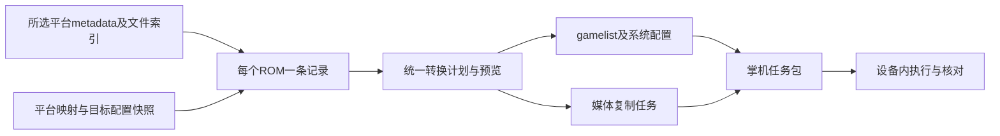

> 历史归档：本文记录当时方案或结果，当前以项目 docs/PLAN.md 和用户后续确认为准。

# 天马G到 ES-DE 的 Python 转换工具设计

初稿：2026-10-10。最新整理：2026-10-12。状态：技术路线已确认，本文是第一版方案的主文档；产品代码尚未开始。用户已决定停止追查三方工具，后续按自己的转换流程推进。

工具将天马G的游戏列表和媒体转换为 Android ES-DE 可用的配置与资源。第一版使用电脑端 Python 解析、规划和生成任务包，由掌机脚本执行大量文件复制；也支持在电脑直接连接的磁盘上执行。用户必须指定一个或多个平台，不默认处理整库。

设计面向不同掌机、存储位置和天马G整合包。输入可以只有 ROM 目录中的天马G元数据和媒体，不要求 ES-DE 已安装资源。保留天马G目录和分类，ROM 不搬动，媒体默认复制到 ES-DE，原始资源继续供天马G使用。

## 方案结论

| 决策 | 首版方案及理由 |
|---|---|
| 电脑还是Android应用 | 电脑Python命令行负责规划；掌机脚本负责复制。重IO发生在掌机，不需要为了设备内复制先开发Android应用 |
| 官方还是改版平台表 | 使用官方ES-DE格式和custom_systems扩展，仅添加或覆盖所选系统；不依赖整合包修改后的整套平台表 |
| Hack/VIB独立还是归并 | 独立系统作为首版默认，复用gba刮削平台和主题。官方GBA下的子目录归并是可行的另一种布局，但首版不自动搬ROM或替用户重组目录 |
| 媒体从哪里来 | 从所选天马G平台的metadata及media目录定位，不假设已有ES-DE媒体；需要的资源完整复制到目标 |
| 三方工具是否作为依赖 | 不依赖维护工具、封面工具或游典导出结果。实现自己的解析、映射和执行计划；源码复用不作为首版前提 |
| 先验证什么 | 使用未改写格式的原包节选，先验证单平台完整流程，再验证多个平台和原库规模；历史派生样本仅保留作对照 |

最小有效流程是：选择一个平台 → 读取metadata和文件索引 → 预览每个ROM及其媒体目标 → 生成gamelist和任务包 → 在掌机执行 → 用同一计划核对实际文件和ES-DE显示。首版最终交付还包含多个平台、备份合并、恢复及可选封面缩放。

## 核心原则：以ROM为单位生成同一份计划

天马G的一个game可以对应多个ROM，媒体只有一套。内部模型首先展开成每个真实ROM一条记录，保存源平台、源游戏、源ROM路径、目标系统、目标系统内ROM相对路径、资料及三类源媒体。gamelist和媒体操作都从这些记录生成，不能各自按不同规则推导名字。

例如红宝石的files列出四个版本，即使原媒体都在media/口袋妖怪 红宝石中，计划也必须生成四条path和四套按各版本文件名命名的媒体。完整映射是4个ROM、4个封面、4个Logo、4个视频，不是4条记录加一套基础游戏名媒体。

导出前检查每条path存在且相对路径有效、同一目标系统中没有重复ROM路径、每个媒体目标与对应ROM路径一致、生成XML可重新解析。游戏显示名相同不作为去重依据；不同目录下的同名ROM保留各自记录和媒体层级。

## 已确定的技术路线

电脑 Python 负责解析、平台映射、XML合并、任务预览和脚本生成；掌机脚本负责批量复制、改名、校验和发布配置。默认原样复制模式只向掌机传递任务包中的少量文本和配置，大媒体直接在掌机内读写。用户选择缩放封面时，任务包额外携带电脑处理后的图片。

单个平台和多个平台使用同一条流程，每次只处理明确选中的平台。采用 ES-DE官方数据格式和自定义系统扩展机制，普通平台复用官方定义，Hack和震动等分类保留独立入口。设备和路径是配置数据，不作为程序常量。

执行方式的选择基于同样本测试：一次 ADB启动脚本的复制耗时中位数为1.099秒，逐文件调用 ADB为2.737秒。数据都在掌机内部复制，差距主要来自36次与1次 ADB调用。掌机手动运行脚本是默认入口；以后由电脑一次触发同一脚本也可避免逐文件调用开销。

## 第一版功能和默认选择

| 项目 | 第一版选择 |
|---|---|
| 程序 | Python 3.9 及以上，命令行入口，核心使用标准库 |
| 转换目标 | Android ES-DE，使用官方 XML、媒体目录和自定义系统机制 |
| 平台选择 | 单个平台或多个指定平台；未选平台不修改 |
| 输入 | 已解压的天马G目录；电脑磁盘或 ADB 可读取的设备存储 |
| ROM | 引用现有目录，只检查存在性，不读取 ROM 内容或复制 ROM |
| 媒体 | 封面、Logo、视频；不导出 mini_boxfront 和 mini_logo |
| 封面 | 默认原样复制；可选将最长边缩至 450 像素，保持比例、不放大 |
| 视频 | 原样复制，不转码 |
| 执行方式 | 默认导出掌机任务包，用户在掌机运行；本地磁盘可直接应用同一任务计划 |
| 已有资源 | 媒体默认保留；配置合并并备份；覆盖媒体必须在生成计划时显式选择 |

首版提供 GBA、GBA hack、GBA vib 的映射和验收样例，其余平台通过相同的映射配置扩展。扫描可以列出所有平台；没有受支持的启动映射时，不生成声称可以启动游戏的配置。第一版不开发 Android 应用或桌面 GUI，不直接处理尚未解压的 ZIP，不合并 Hack 到官方平台，也不迁移存档、BIOS、模拟器核心或安装应用。

## 使用流程和命令接口

运行入口设计为 `python -m frontend_trans_tool`，提供四个命令：

| 命令 | 用途 |
|---|---|
| `scan --profile rp6.json` | 发现平台，显示相对目录、collection 名称、游戏及媒体数量 |
| `plan --profile rp6.json --platform GBA --platform "GBA hack" --out jobs/gba` | 分析指定平台，输出预览报告和可序列化任务计划 |
| `export-script --plan jobs/gba/plan.json` | 从有效计划生成可在掌机独立执行的任务包 |
| `apply-local --plan jobs/gba/plan.json` | 将有效计划应用到电脑可直接访问的目标磁盘 |

`--platform` 可重复，重复值去重，不存在的值报错。平台以元数据文件所在目录相对输入根目录的路径识别，collection 用于显示；不同目录中同名 collection 不自动合并。例如街机的一个子平台可以使用 `Arcade/FBNEO ACT HOT` 作为选择值。

子目录里存在另一份metadata时，将其视为独立源平台边界。选择父平台不会顺带解析子平台的元数据，媒体候选索引也不跨入其他平台。scan只做平台发现和必要的元数据读取；plan只建立所选平台及其目标范围的文件索引，不哈希全库。

配置文件至少包含读取方式 `local` 或 `adb`、源 ROM 根目录、目标 ES-DE 目录、ES-DE 运行时的 ROM 根目录、目标系统模板版本，以及源平台到目标系统的映射。目标媒体根目录默认是 `ES-DE/downloaded_media`；已有 ES-DE配置了其他媒体目录时，使用该设置解析后的目录，并在预览中明确显示。配置也允许显式指定媒体根目录，但必须与 ES-DE运行时媒体设置一致，不能只复制到一个不会被读取的目录。ADB 模式还指定授权设备序列号；每次访问前检查设备列表。设备序列号、存储卡 UUID、盘符和用户目录均由配置提供，不写死在程序中。

如果电脑上的源目录是设备镜像，配置额外记录它对应的设备 ROM 根目录，使生成的脚本能够读取设备上的实际文件。元数据中旧设备的绝对路径通过显式前缀映射定位，不假设另一台设备使用相同存储卡 UUID。

流程为：扫描和选择平台 → 解析元数据 → 定位资源和确认启动映射 → 生成预览计划 → 导出任务包 → 用户传递任务包并在掌机执行 → 查看执行结果。计划中存在未解决的路径冲突、ROM 缺失或启动映射错误时，不能导出可执行任务包。缺失媒体可以继续转换，但必须列出缺项，不生成指向不存在文件的复制任务。

脚本读取的原始媒体必须已经位于配置指定的掌机目录。电脑上的整合包用于规划时，应先将原始天马G资源放到掌机，或将源明确设置为设备镜像；导出脚本不会自动把尚在电脑上的原始媒体传过去。任务包可通过磁盘、文件管理器或一次 ADB传输放到掌机，运行期间电脑可以断开。目录访问权限不足时先停止，不尝试申请 Root或修改系统权限。

## 元数据和平台转换

解析器支持 UTF-8、UTF-8 BOM 和经过明确识别的 GBK，以及 LF、CRLF 和连续空行。支持 `file:` 单文件字段、`files:` 多行文件列表、缩进行和多行文本；不能把 `files:` 当成单个文件，也不能只按游戏显示名称推断 ROM 名称。

每条天马G游戏记录展开为对应 ROM 的 ES-DE 游戏记录。多 ROM 共用描述和媒体时，每个 ROM 使用各自的相对路径，并继承原游戏资料。游戏显示名称保留源名称；版本条目补充 ROM 文件名中的版本部分，以便用户区分，保留完整版本标记，不产生残缺括号。同一目标系统及规范化ROM路径出现重复时合并一致资料；冲突进入报告，不按name去重。

解析前保留原始字节和来源信息，明确记录所用编码；兼容原包实际出现的CRLF、LF混合换行。不能用忽略解码错误的方式丢弃文字，也不能因局部字段无法解析而静默退化为“只扫描文件名”。读取metadata失败是明确错误，不输出缺path或缺全部资料的正常列表。

编码识别先处理UTF-8 BOM，再严格尝试UTF-8；需要GBK时使用已配置或能确认的编码，并在报告中标明。不能确认时停止并要求明确编码。源文件始终只读，解析支持换行差异不等于重新保存天马G文件。

平台信息分成系统标识、展示名称、ROM 目录、真实刮削平台、主题和启动配置。普通 GBA 使用官方 `gba` 系统标识，但路径可以覆盖为 `%ROMPATH%/GBA`；新增 GBA hack 使用 `gbah` 标识、`%ROMPATH%/GBA hack` 路径、`gba` 刮削平台，默认复用 `gba` 主题。新增 GBA vib 使用独立标识 `gbavib`，默认复用 `gba` 主题。目标已有系统且 ROM 路径唯一匹配选中源平台时，复用现有系统标识；多个候选报冲突，必须通过显式映射解决，不能自动制造重复入口。

官方系统模板按 Android ES-DE 版本保存，第一份以当前验证设备的 3.4.1 系列为适配基线。自定义配置只包含新增或需要覆盖的系统，不复制整份整合包的平台表，不使用 `loadExclusive`。现有主题的专用外观通过映射配置选择，工具不修改主题文件。

目录根的规划还要检查ES-DE系统扫描范围是否重叠。若输入已经是gba/GBA hack、gba/GBA vib这种归并布局，不能直接再添加重叠的独立系统并声称分类完成；首版对无法避免重复扫描的独立系统计划报配置冲突，不通过往源ROM目录写noload文件、改全局加载策略或搬动ROM来绕过。已有归并资源先作为正常布局对照，自动重组和归并导出留到后续扩展。

启动命令由受支持的 ES-DE 模板和模拟器映射生成。解析天马G `launch` 中的模拟器包名、核心和配置需求，但不直接执行或照搬整段 `am start`。GBA vib 的 `gpsp_rumble` 与普通 `gpSP` 必须区分；无法表达或无法确认的核心需求列为待配置项，不能静默替换。模拟器安装和目录授权由用户完成。

游戏名称、描述、开发商等资料按语义映射到ES-DE字段；源排序写入可用的排序字段。当前原包的developer经常是游戏名或汉化版本，不能全部当成开发商；明显的版本说明写入描述补充信息，真实开发商才写developer。release只有可识别为合法日期时才转为日期；未支持或无法确定的值保留在计划源资料及报告中。字面量换行转义按已确认的源格式转换为实际段落，使用XML序列化处理特殊字符。

已有gamelist按目标系统及ROM相对路径合并；读取已有绝对路径时先按系统ROM根归一化，新增条目输出以./开头的相对path。默认保留已有字段，只补充空字段和新增条目，尤其保留favorite、playcount、playtime、lastplayed、用户名字、简介和altemulator。旧记录缺path或路径越界时报告，不把其猜测绑定到同名ROM。已有自定义系统与排序配置仅合并选中系统；其他系统和游戏不删除。

参考：[ES-DE 系统与游戏列表格式](https://gitlab.com/es-de/emulationstation-de/-/blob/master/INSTALL.md)、[ES-DE 媒体目录规则](https://gitlab.com/es-de/emulationstation-de/-/blob/master/USERGUIDE.md#manually-copying-game-media-files)。

## 媒体定位和命名

| 天马G媒体 | ES-DE媒体目录 |
|---|---|
| `assets.box_front` 或 `boxfront.*` | `downloaded_media/<system>/covers/` |
| `assets.logo` 或 `logo.*` | `downloaded_media/<system>/marquees/` |
| `assets.video` 或 `video.*` | `downloaded_media/<system>/videos/` |

媒体目标名称从 ROM 在该系统目录下的相对路径生成：保留子目录，去掉 ROM 最后一层扩展名，追加媒体自己的扩展名。例如 `子目录/游戏.zip` 对应 `covers/子目录/游戏.png`。媒体名称不从 `game:` 显示文本生成，因此显示名称中的 `/` 不会被误当成媒体目录。

表中的 `downloaded_media` 表示默认媒体根目录；使用自定义媒体根目录时，后面的系统及媒体类型层级保持相同。任务空间和临时文件检查分别按媒体与配置实际所在存储计算，不能将内置存储的剩余空间当作外置卡的剩余空间。

定位顺序是：显式资产引用 → 对旧绝对路径应用配置中的前缀映射 → 大小写唯一匹配 → 当前游戏的标准媒体目录候选。候选匹配只允许在配置授权的源目录范围内发生。显式引用失败时，先检验 `media/<游戏名>/` 中相应用途文件；如果仍无法定位，只在选中平台的媒体索引中使用唯一候选。修复结果必须记录原引用、实际源文件和理由；多个候选不能自动选一个。

`boxfront`、`boxFront` 等用途名按大小写兼容识别，实际复制路径保持文件真实名称。对于两个 ROM 扩展名不同但目标媒体路径相同的情况，仅允许它们明确共享同一媒体；指向不同内容时阻止计划，不能覆盖其中一个。多个 ROM 共用媒体时，目标文件按各 ROM 名称展开；不依赖硬链接或符号链接，以兼容设备存储。

图片按文件头确定实际格式，目标使用ES-DE支持的.png、.jpg、.webp后缀。默认保持原图片字节，不因为JPEG就转成PNG；源后缀与内容不一致时只更正目标后缀。识别使用图片头部，不完整读取视频。无法识别或不支持的格式列为资源问题，不将其硬命名成PNG。ES-DE媒体匹配依赖目录和文件名，gamelist中不靠image、marquee、video标签补救错误命名。

可选封面缩放由电脑端 Pillow 完成，输出维持原图片格式和透明度，最长边为 450，不放大。JPEG 输出质量固定为 90。生成的封面加入任务包，掌机脚本直接复制，不要求设备安装图片处理工具。源在设备时只批量读取需要处理的封面，不把 Logo 和视频下载再上传。默认不缩放时，任务包不携带媒体。

## 掌机任务包和执行脚本

任务包包含 `apply.sh`、`plan.json`、预览报告、待写入的 XML，以及可选处理后的封面。脚本采用 UTF-8 无 BOM 和 LF，兼容 Android `/system/bin/sh` 和 Toybox，用户通过 `sh apply.sh` 执行。执行不依赖电脑保持连接，也不要求 Python、Root、Shizuku、BusyBox 或联网。

Python 生成完整文件操作命令；脚本不解析 JSON 或 XML，不执行源元数据中的命令。所有路径使用 shell 参数引用处理中文、空格、括号和单引号，不使用 `eval`。含换行符的文件路径第一版报错。设备路径及输出边界在执行前检查；不同设备重新生成任务包，不能沿用旧设备的序列号和存储路径。

执行顺序：

1. 提示用户先退出 ES-DE，避免其内存中的旧列表随后回写。检查命令可用性、源和目标目录、已选平台文件、任务包内容及预计新增空间；排除源目标互相覆盖或目标落入源媒体目录的情况。
2. 核对计划读取时的已有 gamelist、系统和排序配置快照。首次执行仅接受原快照；恢复执行同时接受本任务已发布文件的预期摘要。未经本任务发布的变化，或计划认为不存在的配置现在由其他操作创建时，执行前停止，返回电脑重新生成，避免覆盖新收藏或用户修改。
3. 创建目标媒体目录。每项先复制到目标目录内的临时文件，检查大小后改名；需要跨存储复制时直接在掌机读写。目标媒体默认保留，列入跳过报告；计划显式选择覆盖时才替换，并先备份已有文件。
4. 所有媒体完成后，再备份并写入本次游戏列表和合并配置。每个配置文件以同目录临时文件加改名发布，并记录其发布状态和新摘要。媒体复制失败时不开始发布 XML，保留已完成媒体以便恢复。多个 XML的发布不是整体原子操作；发布中途失败时，部分文件可能已更新，使用发布记录继续恢复，或按保留备份恢复原配置。
5. 写出完成、跳过、失败和修复统计，以及未找到的资源列表，提醒用户重启或重新加载 ES-DE。

已有配置快照在 ADB 规划时读取；本地规划则从直接可访问的目标或明确提供的目标快照读取。首次安装可以声明目标配置不存在，脚本仍核验这一条件。工具不自动改变 ES-DE 的全局 ROM 根目录，用户应将其设为配置中的运行时 ROM 根目录。

执行结果和恢复状态存放在目标 `ES-DE/.frontendtrans/runs/<任务编号>/`。任务编号由生成时确定，恢复记录绑定任务计划摘要，不能用于另一份计划。恢复仍使用同一任务包，检查源文件大小和修改时间是否与计划一致，并检查已完成目标文件大小；源变化时停止，目标缺失或大小不符时重新复制。默认校验采用大小，避免每次完整重读视频；可选 SHA-256 校验用于严格验证。大小与时间检查不是内容一致性的证明，严格校验模式解决这一限制。

源属性记录读取位置和精度。使用电脑镜像规划时，不把镜像的Windows修改时间当作设备源快照；需要从设备补充实际索引，或明确记录首次只能核对源路径和大小。缺少可信源时间时报告这个限制，首次执行记录实际源时间供本任务恢复核对；严格内容保证仍需SHA-256。恢复记录不能用另一份计划或另一台设备的时间值替代。

脚本启动后持续显示进度，最终打印资源操作和配置发布状态。失败停止并返回非零状态。仅清理本任务创建的临时文件，不递归清理现有 ES-DE 目录，不删除目标中额外媒体。配置备份保留供用户恢复；整体转换不是文件系统事务，失败后可能留下本次已复制媒体。

通过 ADB 触发执行作为后续便利入口，使用同一个脚本，不为每个媒体文件启动一次 ADB。第一版以用户在掌机手动执行为默认路径。

## 模块和数据接口

模块按职责划分为文件读取与批量索引、天马G解析、平台和启动映射、转换计划、ES-DE导出、脚本生成、可选图片处理，以及本地执行。转换核心接收已读取的元数据和文件索引，不依赖 ADB 命令或具体设备路径。

| 模块 | 输入与职责 | 输出 |
|---|---|---|
| 来源读取 | 电脑目录或ADB设备、所选平台；批量取得metadata、目录、大小及时间 | 原始元数据、文件索引及目标配置快照 |
| 元数据解析 | 原始字节；处理编码、file/files及字段语义 | 平台、游戏、ROM引用及资料，不执行launch |
| 平台与媒体映射 | ROM引用、文件索引、目标系统及启动模板 | 每个ROM的运行路径、相对路径、三类资产和问题 |
| 转换规划 | 映射记录与已有目标；检查冲突、合并、空间和执行边界 | 同一份plan.json及预览报告 |
| XML与执行导出 | 已验证的plan | gamelist、自定义配置、apply.sh及可选处理后封面 |
| 执行与核对 | 同一任务计划；本地磁盘或掌机脚本 | 原子文件发布、备份、进度、恢复状态和核对结果 |

核心模型包含源平台、游戏记录、ROM引用、媒体资产、目标系统、复制或保留操作、问题和计划。`plan.json` 带格式版本，记录平台选择、路径映射、目标模板版本、每个 ROM 对应的媒体、源大小与时间、目标相对路径、配置快照摘要和操作总量。执行脚本与本地执行器都由同一计划生成，不能分别推导映射。

预览报告按平台展示 ROM 数、游戏条目数、媒体唯一源文件数、展开后的目标文件数、缺项、预计读取和写入字节、额外目标空间以及修复项。共享媒体需要展开时，目标字节数按每个输出文件计算，不能只用唯一源文件总大小估计空间。保留已有媒体时区分已经验证同源与仅因路径存在而跳过，后者不能标为内容一致；选择覆盖时，空间估计计入保留备份的占用。

## IO操作与性能边界

| 阶段 | 实际IO | 控制方式 |
|---|---|---|
| 发现与规划 | 读取少量metadata、目标XML及所选目录索引；读取图片头 | 不读ROM内容，不下载视频；设备图片头及索引按平台批量取得，不逐文件调用ADB |
| 传递任务包 | 传输计划、XML、脚本；可选处理后的封面 | 默认只传文本和配置，媒体已经在掌机源目录 |
| 执行复制 | 每个新增媒体目标一次源读取、一次临时文件写入及改名 | 大媒体在掌机内或跨内置/SD卡复制，已保留或完成的目标跳过 |
| 发布配置 | 读取核对快照、备份旧XML、发布新XML和恢复记录 | 媒体全部完成后发布，避免先写列表再失败 |
| 严格校验 | 额外读取相应源和目标内容计算SHA-256 | 可选；默认大小检查不声称证明内容一致 |

普通GBA示例默认需要503×3=1,509个媒体目标，不复制503个ROM。原天马G只有484×3=1,452个主要媒体源，共享资源需要展开，因此物理文件数量和空间按1,509个目标计算。脚本内部仍需执行这些复制，节省的是ADB往返和经电脑中转的开销，不消除存储读写量。

首次安装目标没有ES-DE媒体时执行全部必要复制；再次运行根据计划和恢复状态跳过已有目标。设备内执行通常能避免USB往返，但速度还取决于SD卡、内置存储、缓存和文件大小，不承诺所有设备都快于电脑直接读卡。性能报告分别计时扫描、规划、复制、发布和校验，不以缺少执行耗时的三方结果推断快慢。

## 已确认的样例和待实现事项

样例来源是普通 GBA 的天马G ROM包与 ES-DE GBA媒体包。绝对文件位置仅用于本机验证，不写入默认规则。

- 天马G有 484 个游戏条目、503 个 ROM，包含 471 个单 ROM 条目和 13 个多 ROM 条目；后者合计 32 个 ROM。
- 天马G普通 GBA媒体有 484 套，每套五种文件，共 2,420 个。ES-DE有 503 套，每套封面、Logo、视频三种，共 1,509 个，与全部 503 个 ROM 的名称对应。
- 展开映射后，503 个 Logo 和 503 个视频均通过逐文件 SHA-256 确认为相同内容。封面均与原文件不同；抽查显示源为 600×600，目标为 450×450。缩放是该样例的处理方式，不是 ES-DE 的强制尺寸。
- `细胞分裂` 三个版本、`细胞分裂 明日潘多拉` 三个版本共享媒体。源列表误写为带 `1+2` 的媒体目录，实际目录不带该后缀，共六条错误引用。必须覆盖路径失败后查找唯一正确目录的场景。
- 同一 ROM包还有 GBA hack 和 GBA vib，它们是可独立选择的平台；普通 GBA媒体包不覆盖这两个平台。不能把三个平台的总数混作普通 GBA 的数量。

测试资源路径：

- `D:\Game Tools\HandheldRes\【 RP6整合包】汐哲社多前端适配天马G整合包和配置包\【1】安装配置包\媒体文件\GBA 媒体.zip`
- `D:\Game Tools\HandheldRes\PegasusG 精简包\PG_天马G_2026新GBA整合包_20260901_Roms.zip`

待实现内容为上述四个命令、目录和批量 ADB 读取、`file/files` 解析、平台映射、媒体索引及错误引用报告、XML 合并、任务计划和预览、掌机脚本与恢复记录、本地执行，以及可选封面缩放。先用 GBA三类平台完成端到端验收，再扩展启动模板；不要求首次运行扫描或转换全库。

## 实现顺序和交付标准

| 阶段 | 可检查的交付物 | 完成标准 |
|---|---|---|
| 1 读取和解析 | 配置加载、电脑目录与批量 ADB读取、平台扫描、元数据模型 | scan可列出平台；正确解析单 ROM、多 ROM、中文路径和源编码，不写入目标 |
| 2 转换计划 | GBA三类平台映射、媒体定位、XML合并、plan命令和报告 | 可选择单个或多个平台；准确预览文件数和字节量；GBA样例展开503个ROM；错误引用及冲突有明确结果 |
| 3 任务执行 | export-script、掌机任务包、本地执行器、备份、进度、恢复和可选严格校验 | 在独立目录完成批量复制和配置发布；模拟中断后恢复；未选平台和原始资源不变 |
| 4 验收和可选缩放 | Pillow封面处理、GBA样例检查、掌机手动执行记录、使用说明 | 原样复制与450像素缩放分别通过；断开电脑执行成功；ES-DE能识别并启动代表性游戏 |

四个阶段都完成并通过验收后，才作为第一版交付。备份、配置合并、平台选择和恢复属于首版要求，不留到正式资源操作之后补做。其他平台采用同一解析和执行流程，逐步补充映射及启动验证；每新增一个平台都要有独立小样本，不通过名称相似性推定启动兼容。

当前验收优先使用原包按字节节选和已下载的设备正常结果，避免人为变更源格式影响判断。代码模块、函数签名和逐任务测试步骤在后续实施计划中展开；本次只整理方案，不实现产品代码。

## 当前验收基线

1. 使用test_data/original_excerpt/Roms的真实节选：3个平台、8个原始条目、15个ROM。metadata的保留段、编码、换行和顺序已按原包核对；不追加合成游戏或媒体。
2. 只选普通GBA时：12个ROM，三类媒体各12个，共36个目标；Hack和VIB无写入。
3. 三个平台都选时：15条有效ROM记录，三类媒体各15个，共45个目标；原包mini图片不导出。
4. 红宝石普通版应生成四条不同path及12个媒体；同一份源媒体分别对应四个ROM名。两组细胞分裂各三个版本应生成各9个媒体，并记录原包已有的6条错误引用处理结果。
5. GT78设备上的643条GBA列表和红宝石四版本12个媒体是正常结构对照；不能要求输出XML字节与设备相同，因为目标设备路径、字段语义与已有资料合并策略可能不同。
6. 原库规模继续验证484条游戏展开为503个ROM及1,509个主要媒体。验收要检查每个路径和内容对应，不能只看数量或游戏名字。
7. 断开电脑的手动脚本、目录权限、跨存储复制、已有资料保护和中断恢复使用独立目标目录实测。当前原包不能提供的边界先标明覆盖不足；寻找对应真实样本，不将历史派生包混作原样来源。

## 脚本可行性测试和验收

2026-10-10 在授权 RP6 上，通过一次 ADB shell 输入脚本，从 SD卡天马G GBA媒体中选取 12 个游戏、36 个封面与 Logo及视频，共 32,766,971 字节（31.25 MiB），复制并改名到内置存储 Download 中独立创建的测试临时目录。纯复制约 1.198 秒，含全部源目标 SHA-256 对比约 3.33 秒；36 个文件校验通过，测试目录已删除，正式游戏和 ES-DE文件未修改。

这个测试验证了中文路径、媒体命名转换、设备内复制、内容校验和清理可行。设备缓存未清空，写入可能经过缓存，样本也较小；不能据此承诺整库耗时。Android 文件管理器或终端执行脚本时的目录权限仍需在目标设备验收，ADB shell 的访问能力不等同于任意执行应用的访问能力。

同日使用同一批 36 个文件、31.25 MiB，进行三轮交替顺序对比。两种方式均在掌机内将 SD卡文件复制并改名到内置存储，使用相同的 `cp --preserve=timestamps`，不经过电脑传输媒体。计时不包含目录准备、SHA-256校验和清理；源文件已通过初始校验预热缓存。

| 轮次 | 一次 ADB启动脚本执行36次复制 | 逐文件启动36次 ADB执行复制 |
|---|---:|---:|
| 1 | 1.152秒 | 2.737秒 |
| 2 | 1.088秒 | 2.796秒 |
| 3 | 1.099秒 | 2.715秒 |
| 中位数 | 1.099秒 | 2.737秒 |

脚本内部复制段的中位数为 1.015秒；其与 1.099秒的差值包含一次 ADB启动及计时命令开销。逐文件 ADB方案总耗时为批量脚本的约2.49倍，脚本节省约59.8%的时间。样本中每文件额外开销约45.5毫秒，支持避免逐文件 ADB调用的设计。两种方式每轮36个目标文件均通过 SHA-256校验，所有测试目录已清理。该比较不包含 `adb pull/push`，也不代表未缓存大文件或其他设备的完整转换耗时。

验收覆盖：

1. 只选 GBA 时，GBA hack、GBA vib及其他平台无写入；同时选几个平台时，配置与统计仅包含所选范围。
2. 解析两种单多文件写法、大小写不同的媒体用途、中文及带空格和单引号的路径；平台同名、目标媒体冲突和越界路径正确报错。
3. GBA样例展开后生成 503 个游戏路径、503 套三类媒体，不复制 968 个 mini图文件；原样复制的 Logo和视频与源内容相同。
4. 六条错误资产引用可定位到唯一正确源文件并记录修复；真正缺失与有多个候选分别报告，不能猜测或复制无关文件。
5. 默认封面原样复制；缩放模式保持比例、透明度和不放大，样例 600×600 输出 450×450。
6. 源和目标处于同一存储或不同存储均可执行；首次目标不存在、已有媒体、空间不足和失去目录权限有明确结果。
7. 中断后重新运行跳过已完成操作；源文件变化或其他操作改变配置快照时停止。媒体复制失败不开始发布 XML；配置发布中途失败时能凭本任务记录恢复，并保留原配置备份。已有收藏、记录、其他系统和原始天马G文件保留。
8. 任务包断开电脑后在掌机手动执行成功。严格校验模式逐文件 SHA-256 一致；实际可访问的目标 ROM经 ES-DE可启动，GBA vib不会静默改用普通核心。
9. 性能记录分开统计索引、文本处理、复制和校验耗时，使用单平台和多个平台的不同规模样本；默认模式没有视频经 USB下载后再上传，也没有逐文件 ADB往返。

按用户2026-10-12的要求，当前主验收资源为原包按字节节选；历史派生用例仅作对照。资源和设备快照保存在本机test_data目录，使用Git忽略规则排除ROM、媒体及个人设备资料，不纳入代码仓库或发布物。掌机验收只使用独立测试输出目录；验证通过后再运行正式任务包。三方工具调查到此暂停，不作为自研实现的依赖或交付前置条件。
